```mermaid
classDiagram
    direction TB

    %% --- Domain Model ---
    class Component {
        <<abstract>>
        -String id
        -String name
        -String brand
        -double price
        +Component(String id, String name, String brand, double price)
        +getId() String
        +getName() String
        +getBrand() String
        +getPrice() double
        +getSpecs()* String
    }

    class CPU {
        -String socket
        -int tdp
        -int performanceScore
        -boolean hasIGPU
        +CPU(String id, String name, String brand, double price, String socket, int tdp, int performanceScore, boolean hasIGPU)
        +getSocket() String
        +getTdp() int
        +getPerformanceScore() int
        +hasIGPU() boolean
        +getSpecs() String
    }

    class Motherboard {
        -String socket
        -String ramType
        -int maxRamGb
        -String formFactor
        +Motherboard(String id, String name, String brand, double price, String socket, String ramType, int maxRamGb, String formFactor)
        +getSocket() String
        +getRamType() String
        +getMaxRamGb() int
        +getFormFactor() String
        +getSpecs() String
    }

    class GPU {
        -int vramGB
        -int powerWatts
        -int performanceScore
        -int lengthMm
        +GPU(String id, String name, String brand, double price, int vramGB, int performanceScore, int powerWatts, int lengthMm)
        +getVramGB() int
        +getPowerWatts() int
        +getPerformanceScore() int
        +getLengthMm() int
        +getSpecs() String
    }

    class RAM {
        -int capacityGB
        -String memoryType
        -int speedMHz
        +RAM(String id, String name, String brand, double price, int capacityGB, String memoryType, int speedMHz)
        +getCapacityGB() int
        +getMemoryType() String
        +getSpeedMHz() int
        +getSpecs() String
    }

    class Storage {
        -int capacityGB
        -String storageType
        -String interfaceType
        +Storage(String id, String name, String brand, double price, int capacityGB, String storageType, String interfaceType)
        +getCapacityGB() int
        +getStorageType() String
        +getInterfaceType() String
        +getSpecs() String
    }

    class PowerSupply {
        -int wattage
        -String efficiencyRating
        -String modularity
        +PowerSupply(String id, String name, String brand, double price, int wattage, String efficiencyRating, String modularity)
        +getWattage() int
        +getEfficiencyRating() String
        +getModularity() String
        +getSpecs() String
    }

    class PCCase {
        -List~String~ supportedFormFactors
        -int maxGpuLengthMm
        +PCCase(String id, String name, String brand, double price, List~String~ supportedFormFactors, int maxGpuLengthMm)
        +getSupportedFormFactors() List~String~
        +getMaxGpuLengthMm() int
        +getSpecs() String
    }

    class Workload {
        <<enumeration>>
        SCHOOLWORK
        GAMING
        VIDEO_EDITING
    }

    class PCBuild {
        -String buildName
        -CPU cpu
        -Motherboard motherboard
        -GPU gpu
        -RAM ram
        -Storage storage
        -PowerSupply powerSupply
        -PCCase pcCase
        -int BASE_SYSTEM_WATTAGE$
        +PCBuild()
        +PCBuild(String buildName)
        +addComponent(Component component) void
        +removeComponent(Class~Component~ componentType) void
        +removeComponent(Component component) void
        +getTotalPrice() double
        +getEstimatedWattage() int
        +getSelectedParts() List~Component~
        +getMissingComponents() List~String~
        +validateCompleteBuild() void
        +validateBudget(double maxBudget) void
        +validateBudget(double minBudget, double maxBudget) void
        +validateCompatibility(CompatibilityChecker checker) void
        +displaySummary() String
        +clearBuild() void
    }

    %% --- Services & Persistence ---
    class PartCatalog {
        -List~Component~ components
        -List~String~ loadWarnings
        +addPart(Component part) void
        +getAllParts() List~Component~
        +size() int
        +findById(String id) Component
        +filterByTypeAndPrice(Class~T~ type, double min, double max) List~T~
        +getPartsByType(Class~T~ type) List~T~
        +filterByPrice(double min, double max) List~Component~
        +filterByTypeAndBrand(Class~T~ type, String brand) List~T~
        +getCheapest(Class~T~ type) T
        +loadFromFile(String filePath) int
        +getLoadWarnings() List~String~
    }

    class CompatibilityChecker {
        +checkAllParts(PCBuild build) boolean
        +checkSocketCompatibility(PCBuild build) boolean
        +checkRamCompatibility(PCBuild build) boolean
        +checkFormFactorCompatibility(PCBuild build) boolean
        +checkGpuClearance(PCBuild build) boolean
        +checkPowerSufficiency(PCBuild build) boolean
        +getCompatibilityReport(PCBuild build) String
    }

    class BottleneckAnalyzer {
        -double BALANCED_CPU_GPU_RATIO$
        -int cpuScore
        -int gpuScore
        -Workload workload
        +BottleneckAnalyzer(int cpuScore, int gpuScore, Workload workload)
        +calculateRatio() double
        +calculateDifference() double
        +getBottleneckLevel() String
        +getBottleneckReport() String
    }

    class BuildRecommender {
        -double PSU_SAFETY_MULTIPLIER$-int BASE_SYSTEM_WATTAGE$
        -PartCatalog catalog
        -PCBuild recommendedBuild
        +BuildRecommender(PartCatalog catalog)
        +generateBuild(double minBudget, double maxBudget, Workload workload, String preferredBrand) PCBuild
        +getRecommendedBuild() PCBuild
    }

    class BuildFileManager {
        -String HEADER$
        -String[] SLOTS$-Class[] TYPES$
        +saveBuild(PCBuild build, String filePath) void
        +loadBuild(String filePath, PartCatalog catalog) PCBuild
    }

    %% --- Custom Exceptions ---
    class ECPCException {
        +ECPCException(String message)
        +ECPCException(String message, Throwable cause)
    }
    class BudgetExceededException {
        +BudgetExceededException(String message)
    }
    class IncompatibleComponentException {
        +IncompatibleComponentException(String message)
    }
    class IncompleteBuildException {
        +IncompleteBuildException(String message)
    }
    class InvalidInputException {
        +InvalidInputException(String message)
    }

    %% --- GUI & Entry Point ---
    class Main {
        +main(String[] arguments)$ void
        -findDatabase()$ Path
    }

    class MainFrame {
        -PartCatalog catalog
        -CompatibilityChecker compatibilityChecker
        -BuildRecommender buildRecommender
        -BuildFileManager buildFileManager
        -PCBuild currentBuild
        -File currentSaveFile
        +installTheme()$ void
        +MainFrame(PartCatalog catalog, String databaseName)
        -runCompatibilityCheck() void
        -analyzeBottleneck() void
        -generateAutomaticBuild() void
        -saveBuild(boolean saveAs) void
        -openBuild() void
    }

    class ECPCTheme {
        +Color BACKGROUND$+Color ACCENT$
        +Font BODY$+install()$ void
        +styleTextField(JTextField field)$ void
        +styleComboBox(JComboBox comboBox)$ void
        +styleScrollPane(JScrollPane scrollPane)$ void
        +styleProgress(JProgressBar progressBar)$ void
    }

    %% --- Relationships ---
    Component <|-- CPU
    Component <|-- Motherboard
    Component <|-- GPU
    Component <|-- RAM
    Component <|-- Storage
    Component <|-- PowerSupply
    Component <|-- PCCase

    ECPCException <|-- BudgetExceededException
    ECPCException <|-- IncompatibleComponentException
    ECPCException <|-- IncompleteBuildException
    ECPCException <|-- InvalidInputException

    PCBuild o-- "0..1" CPU
    PCBuild o-- "0..1" Motherboard
    PCBuild o-- "0..1" GPU
    PCBuild o-- "0..1" RAM
    PCBuild o-- "0..1" Storage
    PCBuild o-- "0..1" PowerSupply
    PCBuild o-- "0..1" PCCase

    PartCatalog *-- "0..*" Component
    BuildRecommender --> "1" PartCatalog
    BuildRecommender o-- "0..1" PCBuild
    BottleneckAnalyzer --> "1" Workload
    CompatibilityChecker ..> PCBuild
    BuildFileManager ..> PCBuild
    BuildFileManager ..> PartCatalog

    Main ..> PartCatalog
    Main ..> MainFrame
    MainFrame *-- "1" PartCatalog
    MainFrame *-- "1" CompatibilityChecker
    MainFrame *-- "1" BuildRecommender
    MainFrame *-- "1" BuildFileManager
    MainFrame o-- "1" PCBuild
    MainFrame ..> BottleneckAnalyzer
```

```mermaid
classDiagram
    direction TB

    namespace Domain_Model {
        class Component {
            <<abstract>>
            -String id
            -String name
            -String brand
            -double price
            +Component(String id, String name, String brand, double price)
            +getId() String
            +getName() String
            +getBrand() String
            +getPrice() double
            +getSpecs()* String
        }

        class CPU {
            -String socket
            -int tdp
            -int performanceScore
            -boolean hasIGPU
            +CPU(String id, String name, String brand, double price, String socket, int tdp, int performanceScore, boolean hasIGPU)
            +getSocket() String
            +getTdp() int
            +getPerformanceScore() int
            +hasIGPU() boolean
            +getSpecs() String
        }

        class Motherboard {
            -String socket
            -String ramType
            -int maxRamGb
            -String formFactor
            +Motherboard(String id, String name, String brand, double price, String socket, String ramType, int maxRamGb, String formFactor)
            +getSocket() String
            +getRamType() String
            +getMaxRamGb() int
            +getFormFactor() String
            +getSpecs() String
        }

        class GPU {
            -int vramGB
            -int powerWatts
            -int performanceScore
            -int lengthMm
            +GPU(String id, String name, String brand, double price, int vramGB, int performanceScore, int powerWatts, int lengthMm)
            +getVramGB() int
            +getPowerWatts() int
            +getPerformanceScore() int
            +getLengthMm() int
            +getSpecs() String
        }

        class RAM {
            -int capacityGB
            -String memoryType
            -int speedMHz
            +RAM(String id, String name, String brand, double price, int capacityGB, String memoryType, int speedMHz)
            +getCapacityGB() int
            +getMemoryType() String
            +getSpeedMHz() int
            +getSpecs() String
        }

        class Storage {
            -int capacityGB
            -String storageType
            -String interfaceType
            +Storage(String id, String name, String brand, double price, int capacityGB, String storageType, String interfaceType)
            +getCapacityGB() int
            +getStorageType() String
            +getInterfaceType() String
            +getSpecs() String
        }

        class PowerSupply {
            -int wattage
            -String efficiencyRating
            -String modularity
            +PowerSupply(String id, String name, String brand, double price, int wattage, String efficiencyRating, String modularity)
            +getWattage() int
            +getEfficiencyRating() String
            +getModularity() String
            +getSpecs() String
        }

        class PCCase {
            -List~String~ supportedFormFactors
            -int maxGpuLengthMm
            +PCCase(String id, String name, String brand, double price, List~String~ supportedFormFactors, int maxGpuLengthMm)
            +getSupportedFormFactors() List~String~
            +getMaxGpuLengthMm() int
            +getSpecs() String
        }

        class Workload {
            <<enumeration>>
            SCHOOLWORK
            GAMING
            VIDEO_EDITING
        }

        class PCBuild {
            -String buildName
            -CPU cpu
            -Motherboard motherboard
            -GPU gpu
            -RAM ram
            -Storage storage
            -PowerSupply powerSupply
            -PCCase pcCase
            -int BASE_SYSTEM_WATTAGE$
            +PCBuild()
            +PCBuild(String buildName)
            +getBuildName() String
            +setBuildName(String buildName) void
            +getCpu() CPU
            +setCpu(CPU cpu) void
            +getMotherboard() Motherboard
            +setMotherboard(Motherboard motherboard) void
            +getGpu() GPU
            +setGpu(GPU gpu) void
            +getRam() RAM
            +setRam(RAM ram) void
            +getStorage() Storage
            +setStorage(Storage storage) void
            +getPowerSupply() PowerSupply
            +getPsu() PowerSupply
            +setPowerSupply(PowerSupply powerSupply) void
            +setPsu(PowerSupply powerSupply) void
            +getPcCase() PCCase
            +setPcCase(PCCase pcCase) void
            +addComponent(Component component) void
            +removeComponent(Class~Component~ componentType) void
            +removeComponent(Component component) void
            +getTotalPrice() double
            +getEstimatedWattage() int
            +getSelectedParts() List~Component~
            +getMissingComponents() List~String~
            +validateCompleteBuild() void
            +validateBudget(double maxBudget) void
            +validateBudget(double minBudget, double maxBudget) void
            +validateCompatibility(CompatibilityChecker checker) void
            +displaySummary() String
            -appendPart(StringBuilder summary, String label, Component part) void
            +clearBuild() void
        }
    }

    namespace Services_And_Persistence {
        class PartCatalog {
            -List~Component~ components
            -List~String~ loadWarnings
            +addPart(Component part) void
            +getAllParts() List~Component~
            +size() int
            +findById(String id) Component
            +filterByTypeAndPrice(Class~T~ type, double min, double max) List~T~
            +getPartsByType(Class~T~ type) List~T~
            +filterByPrice(double min, double max) List~Component~
            +filterByTypeAndBrand(Class~T~ type, String brand) List~T~
            +getCheapest(Class~T~ type) T
            +loadFromFile(String filePath) int
            +getLoadWarnings() List~String~
            -createComponent(Map~String, Object~ data)$ Component
        }

        class CompatibilityChecker {
            +checkAllParts(PCBuild build) boolean
            +checkSocketCompatibility(PCBuild build) boolean
            +checkRamCompatibility(PCBuild build) boolean
            +checkFormFactorCompatibility(PCBuild build) boolean
            +checkGpuClearance(PCBuild build) boolean
            +checkPowerSufficiency(PCBuild build) boolean
            +getCompatibilityReport(PCBuild build) String
        }

        class BottleneckAnalyzer {
            -double BALANCED_CPU_GPU_RATIO$
            -int cpuScore
            -int gpuScore
            -Workload workload
            +BottleneckAnalyzer(int cpuScore, int gpuScore, Workload workload)
            +BottleneckAnalyzer(int cpuScore, int gpuScore, String workload)
            +calculateRatio() double
            +calculateDifference() double
            +getBottleneckLevel() String
            +getBottleneckReport() String
            +getWorkload() Workload
            +getCpuScore() int
            +getGpuScore() int
        }

        class BuildRecommender {
            -double PSU_SAFETY_MULTIPLIER$
            -int BASE_SYSTEM_WATTAGE$-double SCORE_TIE_TOLERANCE$
            -PartCatalog catalog
            -PCBuild recommendedBuild
            +BuildRecommender(PartCatalog catalog)
            +generateBuild(double minBudget, double maxBudget, Workload workload, String preferredBrand) PCBuild
            +getRecommendedBuild() PCBuild
        }

        class BuildFileManager {
            -String HEADER$
            -String[] SLOTS$-Class[] TYPES$
            +saveBuild(PCBuild build, String filePath) void
            +loadBuild(String filePath, PartCatalog catalog) PCBuild
        }
    }

    namespace Custom_Exceptions {
        class ECPCException {
            +ECPCException(String message)
            +ECPCException(String message, Throwable cause)
        }

        class BudgetExceededException {
            +BudgetExceededException(String message)
        }

        class IncompatibleComponentException {
            +IncompatibleComponentException(String message)
        }

        class IncompleteBuildException {
            +IncompleteBuildException(String message)
        }

        class InvalidInputException {
            +InvalidInputException(String message)
        }
    }

    namespace Presentation_GUI {
        class Main {
            +main(String[] arguments)$ void
            -findDatabase()$ Path
        }

        class MainFrame {
            -PartCatalog catalog
            -CompatibilityChecker compatibilityChecker
            -BuildRecommender buildRecommender
            -BuildFileManager buildFileManager
            -Map~Class, JComboBox~ componentSelectors
            -String databaseName
            -PCBuild currentBuild
            -File currentSaveFile
            -boolean updatingSelectors
            +installTheme()$ void
            +MainFrame(PartCatalog catalog, String databaseName)
            -runCompatibilityCheck() void
            -analyzeBottleneck() void
            -generateAutomaticBuild() void
            -saveBuild(boolean saveAs) void
            -openBuild() void
            -refreshOverview() void
        }

        class ECPCTheme {
            +Color BACKGROUND$+Color SIDEBAR$
            +Color PANEL$+Color SURFACE$
            +Color DEEP$+Color BORDER$
            +Color ACCENT$+Color ACCENT_HOVER$
            +Color PURPLE$+Color TEXT$
            +Color MUTED$+Color SUCCESS$
            +Color WARNING$+Font BODY$
            +Font LABEL$+Font CAPTION$
            +Font OVERLINE$+Font SECTION$
            +Font PAGE_TITLE$+Font METRIC$
            +Font REPORT$+Font REPORT_HEADING$
            -ECPCTheme()
            +install()$ void
            +styleTextField(JTextField field)$ void
            +styleComboBox(JComboBox comboBox)$ void
            +styleScrollPane(JScrollPane scrollPane)$ void
            +styleProgress(JProgressBar progressBar)$ void
        }
    }

    %% --- Inheritance ---
    Component <|-- CPU : extends
    Component <|-- Motherboard : extends
    Component <|-- GPU : extends
    Component <|-- RAM : extends
    Component <|-- Storage : extends
    Component <|-- PowerSupply : extends
    Component <|-- PCCase : extends

    ECPCException <|-- BudgetExceededException : extends
    ECPCException <|-- IncompatibleComponentException : extends
    ECPCException <|-- IncompleteBuildException : extends
    ECPCException <|-- InvalidInputException : extends

    %% --- Aggregation & Composition ---
    PCBuild o-- "0..1" CPU : selects
    PCBuild o-- "0..1" Motherboard : selects
    PCBuild o-- "0..1" GPU : selects
    PCBuild o-- "0..1" RAM : selects
    PCBuild o-- "0..1" Storage : selects
    PCBuild o-- "0..1" PowerSupply : selects
    PCBuild o-- "0..1" PCCase : selects

    PartCatalog *-- "0..*" Component : stores
    BuildRecommender --> "1" PartCatalog : queries
    BuildRecommender o-- "0..1" PCBuild : generates
    BottleneckAnalyzer --> "1" Workload : evaluates for

    MainFrame *-- "1" PartCatalog : owns
    MainFrame *-- "1" CompatibilityChecker : owns
    MainFrame *-- "1" BuildRecommender : owns
    MainFrame *-- "1" BuildFileManager : owns
    MainFrame o-- "1" PCBuild : manages

    %% --- Dependencies ---
    Main ..> PartCatalog : initializes
    Main ..> MainFrame : launches
    CompatibilityChecker ..> PCBuild : validates
    BuildFileManager ..> PCBuild : serializes
    BuildFileManager ..> PartCatalog : resolves IDs
    BuildFileManager ..> Component : maps slots
    PCBuild ..> CompatibilityChecker : delegates check
    PCBuild ..> Component : aggregates
    PCBuild ..> IncompleteBuildException : throws
    PCBuild ..> BudgetExceededException : throws
    PCBuild ..> InvalidInputException : throws
    MainFrame ..> BottleneckAnalyzer : instantiates
    MainFrame ..> ECPCTheme : styles UI
```

<p align="center">
  
</p>

<div align="center">

# 🖥️ ECPC: Efficient Custom Personal Computer Builder

**Batangas State University — The National Engineering University**  
*College of Informatics and Computing Sciences | Computer Science Department*  
*OOP 101: Object-Oriented Programming (1st Semester, AY 2026-2027)*

[](https://www.oracle.com/java/)
[]()
[]()

</div>

---

## 📖 About the Project
Building a custom personal computer is a technical task that can be overwhelming for beginners. Choosing incompatible parts or mismanaging your budget leads to wasted time, money, and hardware performance bottlenecks. 

**ECPC (Efficient Custom Personal Computer Builder)** is a Java-based gui application designed to help students, first-time PC builders, and hobbyists plan, validate, and optimize custom PC builds based on budget, intended workload (schoolwork, gaming, or video editing), and brand preferences.

---

## 🎯 Problem Being Addressed
* **Hardware Incompatibility:** Manually verifying sockets, RAM types, power draws, and case clearances is error-prone.
* **Budget Misallocation:** Users often overspend on unbalanced components (e.g., pairing an expensive GPU with a weak CPU).
* **Technical Complexity:** Beginners lack intuitive guidance when navigating complex hardware specifications.

---

## 🚀 Project Objectives

### General Objective
To develop a Java-based application that guides users in designing a compatible PC build within their budget by validating component compatibility and power requirements, rating the CPU-GPU balance, and recommending parts tailored to the user's workload.

### Specific Objectives
1. **Parts Catalog:** Load CPUs, motherboards, GPUs, RAM, storage, power supplies, and cases from a local data file with specifications, performance scores, and prices.
2. **Compatibility Validation:** Check CPU-motherboard sockets, RAM types/capacities, case form factors vs. GPU lengths, and PSU wattage safety margins.
3. **Auto-Build:** Automatically recommend a complete, compatible build within a specified minimum and maximum budget range.
4. **Bottleneck Detector:** Rate CPU-GPU balance as *Balanced*, *Moderate*, or *Severe* for the chosen workload.
5. **Custom Builds:** Allow users to create, edit, save, and load custom PC builds.
6. **Application of Object-Oriented Programming Principles:** Demonstrate core Object-Oriented Programming principles to ensure extensibility for new component types.

---

## 👥 Target Users

| Target User | How They Will Use the System |
| :--- | :--- |
| **Students** | Enter a budget range and school/light-gaming workload to receive affordable, compatible part recommendations. |
| **First-Time PC Buyers** | Input preferences to generate optimized builds while receiving warnings against incompatibilities or performance mismatches. |
| **PC Hobbyists** | Input custom part lists through the Custom Build feature to check compatibility, power draw, and bottlenecks before saving. |

---

## ✨ Main Features

* 🔍 **Compatibility Checker:** Verifies socket types, dimensions, form factors, and power sufficiency.
* ⚖️ **Bottleneck Detector:** Compares CPU and GPU performance relative to the chosen workload to flag potential performance bottlenecks.
* ⚙️ **Auto Build and Budget Optimizer:** Generates optimal builds matching user budgets and brand preferences.
* 🛠️ **Custom Build:** Lets users add, replace, or remove specific parts for a build they have in mind, with the running total cost and compatibility status shown as they edit.
* 💾 **Save & Load Builds:** Persist and retrieve your custom configurations from local files.

---

## 🛠️ Technologies Used
* **Programming Language:** Java
* **GUI Framework:** Java Swing
* **Data Format:** JSON (for storing PC component information)
* **Development Environment:** Visual Studio Code (VS Code)
* **Version Control:** Git and GitHub
* **Java Development Kit (JDK):** JDK 21
* **Compilation Tool:** Java Compiler (javac)
* **Application Packaging Tool:** Java Archive Tool (jar)
* **Application Distribution Format:** Executable JAR (.jar)
* **File Handling:** Java I/O and NIO (for saving and loading custom PC builds)

---

## 🧱 OOP Concepts Demonstrated

* **Classes and Objects:** Defines blueprints for hardware and system logic (such as `Component`, `CPU`, `Motherboard`, `GPU`, `RAM`, `Storage`, `PowerSupply`, `PCCase`, `PCBuild`, and `PartCatalog`), with objects representing individual catalog parts, the user's current build, and generated reports.
* **Methods:** Encapsulates core operations including calculating total costs and estimated wattage (`PCBuild`), running compatibility checks (`CompatibilityChecker`), computing CPU-GPU balance (`BottleneckAnalyzer`), and generating recommended builds (`BuildRecommender`).
* **Encapsulation:** Keeps attributes like price, socket type, wattage, dimensions, and performance scores private and accessed via public getters, while catalog parts have no setters to prevent modification after loading and build updates pass through validating methods like `addComponent()`.
  ```java
  public abstract class Component {
      private final String id;
      private final String name;
      private final String brand;
      private final double price;

      public String getId() { return id; }
      public String getName() { return name; }
      public String getBrand() { return brand; }
      public double getPrice() { return price; }
  }
  ```

* **Inheritance:** Uses the abstract class `Component` to hold shared attributes (`ID`, `name`, `brand`, `price`), which `CPU`, `Motherboard`, `GPU`, `RAM`, `Storage`, `PowerSupply`, and `PCCase` extend to add their own specifications and avoid repeated code.
  ```java
  public class CPU extends Component {
      private final String socket;
      private final int tdp;
      private final int performanceScore;
      private final boolean hasIGPU;

      public CPU(String id, String name, String brand, double price,
                 String socket, int tdp, int performanceScore, boolean hasIGPU) {
          super(id, name, brand, price);
          this.socket = socket;
          this.tdp = tdp;
          this.performanceScore = performanceScore;
          this.hasIGPU = hasIGPU;
      }
  }
  ```

* **Polymorphism:** Handles all parts uniformly as `Component` objects (such as storing them in a single list and displaying them in a single loop) while each subclass overrides `getSpecs()` with specialized behavior.
  ```java
  // CPU.java
  @Override
  public String getSpecs() {
      return "Socket: " + socket + " | TDP: " + tdp + "W | Score: " + performanceScore + " | Integrated Graphics: " + hasIGPU;
  }

  // GPU.java
  @Override
  public String getSpecs() {
      return "VRAM: " + vramGB + "GB | Power: " + powerWatts + "W | Score: " + performanceScore + " | Length: " + lengthMm + "mm";
  }
  ```

* **Abstraction:** Relies on the abstract class `Component` to declare mandatory methods for every part, hiding complex calculations like wattage totals and bottleneck formulas behind simple method calls for the GUI.
  ```java
  public abstract class Component {
      public abstract String getSpecs();
  }
  ```
* **Exception Handling:** Employs custom exceptions (such as `IncompatibleComponentException`, `BudgetExceededException`, and `InvalidInputException`) alongside try-catch blocks to handle invalid inputs, incompatible parts, unfeasible budgets, and missing or corrupted files without crashing the program.
* **Arrays/Data Handling:** Utilizes `ArrayList` collections to store the parts catalog, the components in the active build, and the collection of saved builds.

---

## 👷 Team Members & Roles

| Team Member | Role | Assigned Tasks |
| :--- | :--- | :--- |
| **Palma, Tristan P.** | Project Leader | Coordinates tasks, monitors deadlines, communicates with the instructor, and facilitates team meetings. |
| **Carandang, Sean Christ Trez' Davidoff A.** | Lead Programmer | Coordinates the implementation of Java classes, methods, and OOP features. |
| **Palor, Christian Gene C.** | System / Design Lead | Develops system requirements, class designs, UML diagrams, and overall application structure. |

---

## 💻 Instructions for Running the Program

1. 

---

## 📸 Sample Screenshots


---

## ⚠️ Known Limitations
* **No Live Pricing:** Prices and specifications are derived from a static local dataset.
* **Estimated Benchmarks:** Performance scores and bottleneck ratings rely on fixed reference scores rather than real-time hardware diagnostics.
* **Standard Desktop Parts Only:** Specialized server hardware, laptops, pre-builts, custom liquid cooling loops, and individual CPU coolers/case fans are excluded.
* **Local Storage Only:** No user accounts or cloud storage features; all saved builds reside in local files.

---

## 🔮 Future Improvements
Although ECPC already provides essential PC building and recommendation functionalities, several improvements can be considered for future versions:

* **Expanded Component Database:** Include more PC components, brands, models, and updated hardware specifications to provide users with a wider range of choices.
* **More Accurate Bottleneck Analysis:** Improve the analysis algorithm by incorporating more realistic performance data, workload-specific calculations, and benchmark information.
* **Advanced Compatibility Checking:** Expand compatibility validation to cover additional hardware specifications and requirements, ensuring more accurate component recommendations.
* **Improved Build Recommendations:** Enhance the recommendation algorithm to consider more factors, such as component performance, price-to-performance ratio, upgrade potential, and user preferences.
* **Price Updates and Comparison:** Introduce updated component pricing and price comparisons from different retailers to help users make more cost-effective decisions.
* **Build Exporting and Sharing:** Allow users to export their PC configurations into formats such as PDF or share their builds with other users.
* **Enhanced User Interface:** Further improve the graphical interface with additional customization options, better navigation, and a more user-friendly experience.
* **User Accounts and Build History:** Introduce user accounts that allow users to save multiple PC configurations and access their previous builds.

---

## 🗂️ Project Contributors & Repository
* **Team Name:** An Family (Section: CS 2101)
* **GitHub Repository:** [ECPC-Efficient-Custom-Personal-Computer-Builder](https://github.com/AN-FAMILY-OOP101/ECPC-Efficient-Custom-Personal-Computer-Builder.git)

## 📐 UML Class Diagram



## 📐 UML Class Diagram


