<div align="center">

# 🖥️ ECPC: Efficient Custom Personal Computer Builder

**Batangas State University — The National Engineering University**  
*College of Informatics and Computing Sciences | Computer Science Department*  
*OOP 101: Object-Oriented Programming (1st Semester, AY 2026-2027)*

[](https://www.oracle.com/java/)
[]()
[]()

</div>

---

## 📖 About the Project
Building a custom personal computer is a technical task that can be overwhelming for beginners. Choosing incompatible parts or mismanaging your budget leads to wasted time, money, and hardware performance bottlenecks[cite: 6]. 

**ECPC (Efficient Custom Personal Computer Builder)** is a Java-based console application designed to help students, first-time PC builders, and hobbyists plan, validate, and optimize custom PC builds based on budget, intended workload (schoolwork, gaming, or video editing), and brand preferences[cite: 6].

---

## 🎯 Problem Being Addressed
* **Hardware Incompatibility:** Manually verifying sockets, RAM types, power draws, and case clearances is error-prone[cite: 6].
* **Budget Misallocation:** Users often overspend on unbalanced components (e.g., pairing an expensive GPU with a weak CPU)[cite: 6].
* **Technical Complexity:** Beginners lack intuitive guidance when navigating complex hardware specifications[cite: 6].

---

## 🚀 Project Objectives

### General Objective
To develop a Java-based application that guides users in designing a compatible PC build within their budget by validating component compatibility and power requirements, rating the CPU-GPU balance, and recommending parts tailored to the user's workload[cite: 6].

### Specific Objectives
1. **Parts Catalog:** Load CPUs, motherboards, GPUs, RAM, storage, power supplies, and cases from a local data file with specifications, performance scores, and prices[cite: 6].
2. **Compatibility Validation:** Check CPU-motherboard sockets, RAM types/capacities, case form factors vs. GPU lengths, and PSU wattage safety margins[cite: 6].
3. **Auto-Build:** Automatically recommend a complete, compatible build within a specified minimum and maximum budget range[cite: 6].
4. **Bottleneck Detector:** Rate CPU-GPU balance as *Balanced*, *Moderate*, or *Severe* for the chosen workload[cite: 6].
5. **Custom Builds:** Allow users to create, edit, save, and load custom PC builds[cite: 6].
6. **Application of Object-Oriented Programming Principles:** Demonstrate core Object-Oriented Programming principles to ensure extensibility for new component types[cite: 6].

---

## 👥 Target Users

| Target User | How They Will Use the System |
| :--- | :--- |
| **Students** | Enter a budget range and school/light-gaming workload to receive affordable, compatible part recommendations[cite: 6]. |
| **First-Time PC Buyers** | Input preferences to generate optimized builds while receiving warnings against incompatibilities or performance mismatches[cite: 6]. |
| **PC Hobbyists** | Input custom part lists through the Custom Build feature to check compatibility, power draw, and bottlenecks before saving[cite: 6]. |

---

## ✨ Main Features

* 🔍 **Compatibility Checker:** Verifies socket types, dimensions, form factors, and power sufficiency[cite: 6].
* ⚖️ **Bottleneck Detector:** Compares CPU and GPU performance relative to the chosen workload to flag potential performance bottlenecks[cite: 6].
* ⚙️ **Auto Build and Budget Optimizer:** Generates optimal builds matching user budgets and brand preferences[cite: 6].
* 🛠️ **Custom Build:** Lets users add, replace, or remove specific parts for a build they have in mind, with the running total cost and compatibility status shown as they edit[cite: 6].
* 💾 **Save & Load Builds:** Persist and retrieve your custom configurations from local files[cite: 6].

---

## 🛠️ Technologies Used
* **Programming Language:** Java[cite: 6] 

---

## 🧱 OOP Concepts Demonstrated

* **Classes and Objects:** Defines blueprints for hardware and system logic (such as `Component`, `CPU`, `Motherboard`, `GPU`, `RAM`, `Storage`, `PowerSupply`, `PCCase`, `PCBuild`, and `PartsCatalog`), with objects representing individual catalog parts, the user's current build, and generated reports[cite: 6].
* **Methods:** Encapsulates core operations including calculating total costs and estimated wattage (`PCBuild`), running compatibility checks (`CompatibilityChecker`), computing CPU-GPU balance (`BottleneckAnalyzer`), and generating recommended builds (`BuildRecommender`)[cite: 6].
* **Encapsulation:** Keeps attributes like price, socket type, wattage, dimensions, and performance scores private and accessed via public getters, while catalog parts have no setters to prevent modification after loading and build updates pass through validating methods like `addComponent()`[cite: 6].
* **Inheritance:** Uses the abstract class `Component` to hold shared attributes (`ID`, `name`, `brand`, `price`), which `CPU`, `Motherboard`, `GPU`, `RAM`, `Storage`, `PowerSupply`, and `PCCase` extend to add their own specifications and avoid repeated code[cite: 6].
* **Polymorphism:** Handles all parts uniformly as `Component` objects (such as storing them in a single list and displaying them in a single loop) while each subclass overrides methods like `getSpecs()` and `checkCompatibility()` with specialized behavior[cite: 6].
* **Abstraction:** Relies on the abstract class `Component` to declare mandatory methods for every part, hiding complex calculations like wattage totals and bottleneck formulas behind simple method calls for the menu code[cite: 6].
* **Exception Handling:** Employs custom exceptions (such as `IncompatibleComponentException`, `BudgetExceededException`, and `InvalidInputException`) alongside try-catch blocks to handle invalid inputs, incompatible parts, unfeasible budgets, and missing or corrupted files without crashing the program[cite: 6].
* **Arrays/Data Handling:** Utilizes `ArrayList` collections to store the parts catalog, the components in the active build, and the collection of saved builds[cite: 6].

---

## 📐 System Architecture (UML Class Diagram)

```mermaid
classDiagram
    direction TB

    class Main {
        +main(String[] args) void
    }

    class Component {
        <<abstract>>
        -String id
        -String name
        -String brand
        -double price
        +getId() String
        +getName() String
        +getBrand() String
        +getPrice() double
        +getSpecs()* String
    }

    class CPU {
        -String socket
        -int tdp
        -int performanceScore
        -boolean integratedGraphics
        +getSocket() String
        +getTdp() int
        +getPerformanceScore() int
        +isIntegratedGraphics() boolean
        +getSpecs() String
    }

    class GPU {
        -int vramGB
        -int powerWatts
        -int performanceScore
        -int lengthMm
        +getVramGB() int
        +getPowerWatts() int
        +getPerformanceScore() int
        +getLengthMm() int
        +getSpecs() String
    }

    class Motherboard {
        -String socket
        -String ramType
        -int maxRamGb
        -String formFactor
        +getSocket() String
        +getRamType() String
        +getMaxRamGb() int
        +getFormFactor() String
        +getSpecs() String
    }

    class RAM {
        -int capacityGB
        -String memoryType
        -int speedMHz
        -int modules
        +getCapacityGB() int
        +getMemoryType() String
        +getSpeedMHz() int
        +getModules() int
        +getSpecs() String
    }

    class Storage {
        -int capacityGB
        -String storageType
        -String interfaceType
        +getCapacityGB() int
        +getStorageType() String
        +getInterfaceType() String
        +getSpecs() String
    }

    class PowerSupply {
        -int wattage
        -String efficiencyRating
        -String modularity
        +getWattage() int
        +getEfficiencyRating() String
        +getModularity() String
        +getSpecs() String
    }

    class PCCase {
        -List~String~ supportedFormFactors
        -int maxGpuLengthMm
        +getSupportedFormFactors() List~String~
        +getMaxGpuLengthMm() int
        +getSpecs() String
    }

    class PartsCatalog {
        -List~Component~ availableParts
        +loadParts(String filePath) void
        +getPartsByCategory(String category) List~Component~
        +getAllParts() List~Component~
    }

    class PCBuild {
        -List~Component~ components
        -double budget
        +addComponent(Component c) void
        +removeComponent(Component c) void
        +calculateTotal() double
        +calculateTotalWattage() int
        +getCpu() CPU
        +getGpu() GPU
        +getMotherboard() Motherboard
        +getRam() RAM
        +getStorage() Storage
        +getPsu() PowerSupply
        +getPcCase() PCCase
    }

    class BuildRecommender {
        +recommendBuild(double budget, String useCase, PartsCatalog catalog) PCBuild
    }

    class SaveAndLoad {
        +saveBuild(PCBuild build, String filePath) void
        +loadBuild(String filePath) PCBuild
    }

    class CompatibilityChecker {
        +checkAllParts(PCBuild build) boolean
        +checkSocketCompatibility(PCBuild build) boolean
        +checkRamCompatibility(PCBuild build) boolean
        +checkFormFactorCompatibility(PCBuild build) boolean
        +checkGpuClearance(PCBuild build) boolean
        +checkPowerSufficiency(PCBuild build) boolean
        +getCompatibilityReport(PCBuild build) String
    }

    class BottleneckAnalyzer {
        -double CPU_MIN$-double CPU_MAX$
        -double GPU_MIN$-double GPU_MAX$
        -int cpuScore
        -int gpuScore
        -String workload
        +normalizeCpu() double
        +normalizeGpu() double
        +calculateDifference() double
        +getBottleneckLevel() String
        +getBottleneckReport() String
    }

    class Exception {
        <<Java Standard>>
    }

    class ECPCException {
        +ECPCException(String message)
    }

    class InvalidInputException {
        +InvalidInputException(String message)
    }

    class BudgetException {
        +BudgetException(String message)
    }

    class IncompatibilityException {
        +IncompatibilityException(String message)
    }

    class IncompleteBuildException {
        +IncompleteBuildException(String message)
    }

    %% Inheritance Relationships
    Component <|-- CPU
    Component <|-- GPU
    Component <|-- Motherboard
    Component <|-- RAM
    Component <|-- Storage
    Component <|-- PowerSupply
    Component <|-- PCCase

    Exception <|-- ECPCException
    ECPCException <|-- InvalidInputException
    ECPCException <|-- BudgetException
    ECPCException <|-- IncompatibilityException
    ECPCException <|-- IncompleteBuildException

    %% Aggregation Relationships
    PartsCatalog o-- Component : stores
    PCBuild o-- Component : aggregates

    %% Dependency Relationships
    Main ..> PartsCatalog : loads
    Main ..> PCBuild : manages
    Main ..> BuildRecommender : requests build
    Main ..> SaveAndLoad : saves/loads
    Main ..> CompatibilityChecker : validates
    Main ..> BottleneckAnalyzer : analyzes
    Main ..> ECPCException : catches

    BuildRecommender ..> PartsCatalog : queries
    BuildRecommender ..> PCBuild : builds
    SaveAndLoad ..> PCBuild : serializes
    CompatibilityChecker ..> PCBuild : inspects
    BottleneckAnalyzer ..> PCBuild : evaluates
```



---

## 👷 Team Members & Roles

| Team Member | Role | Assigned Tasks |
| :--- | :--- | :--- |
| **Palma, Tristan P.** | Project Leader | Coordinates tasks, monitors deadlines, communicates with the instructor, and facilitates team meetings[cite: 6]. |
| **Carandang, Sean Christ Trez' Davidoff A.** | Lead Programmer | Coordinates the implementation of Java classes, methods, and OOP features[cite: 6]. |
| **Palor, Christian Gene C.** | System / Design Lead | Develops system requirements, class designs, UML diagrams, and overall application structure[cite: 6]. |

---

## 💻 Instructions for Running the Program

1. Clone the repository to your local machine:
   ```bash
   git clone [https://github.com/AN-FAMILY-OOP101/ECPC-Efficient-Custom-Personal-Computer-Builder.git](https://github.com/AN-FAMILY-OOP101/ECPC-Efficient-Custom-Personal-Computer-Builder.git)
   ```
2. Navigate to the `src` directory:
   ```bash
   cd ECPC-Efficient-Custom-Personal-Computer-Builder/src
   ```
3. Compile all Java source files:
   ```bash
   javac *.java
   ```
4. Run the main application:
   ```bash
   java Main
   ```

---

## 📸 Sample Screenshots

*Screenshots of the console menu, compatibility check reports, and bottleneck ratings will be added here.*

---

## ⚠️ Known Limitations
* **No Live Pricing:** Prices and specifications are derived from a static local dataset[cite: 6].
* **Estimated Benchmarks:** Performance scores and bottleneck ratings rely on fixed reference scores rather than real-time hardware diagnostics[cite: 6].
* **Standard Desktop Parts Only:** Specialized server hardware, laptops, pre-builts, custom liquid cooling loops, and individual CPU coolers/case fans are excluded[cite: 6].
* **Local Storage Only:** No user accounts or cloud storage features; all saved builds reside in local files[cite: 6].

---

## 🔮 Future Improvements
* **Graphical User Interface (GUI):** Transition from a console-based menu to a JavaFX or Swing desktop interface.
* **Live Store Price Scraping:** Integrate real-time pricing and stock checks from local retailers (PC Express and EasyPC).
* **Expanded Hardware Categories:** Add support for CPU coolers, case fans, and multi-drive storage configurations.

---

## 🗂️ Project Contributors & Repository
* **Team Name:** An Family (Section: CS 2101)[cite: 6]
* **GitHub Repository:** [ECPC-Efficient-Custom-Personal-Computer-Builder](https://github.com/AN-FAMILY-OOP101/ECPC-Efficient-Custom-Personal-Computer-Builder.git)[cite: 6]
